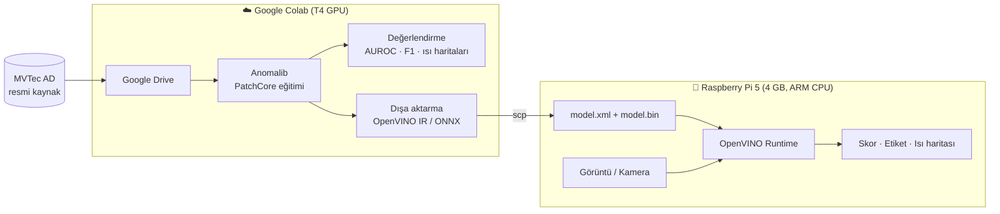
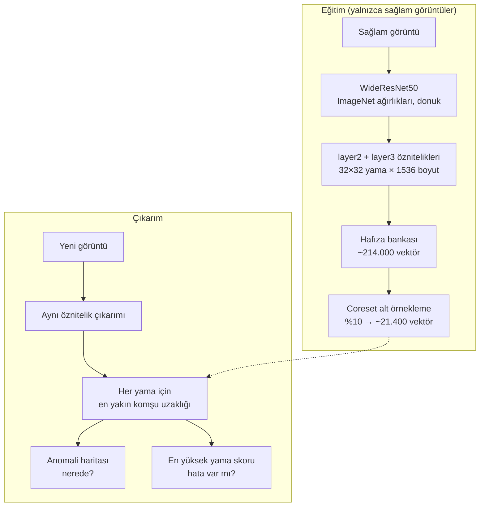
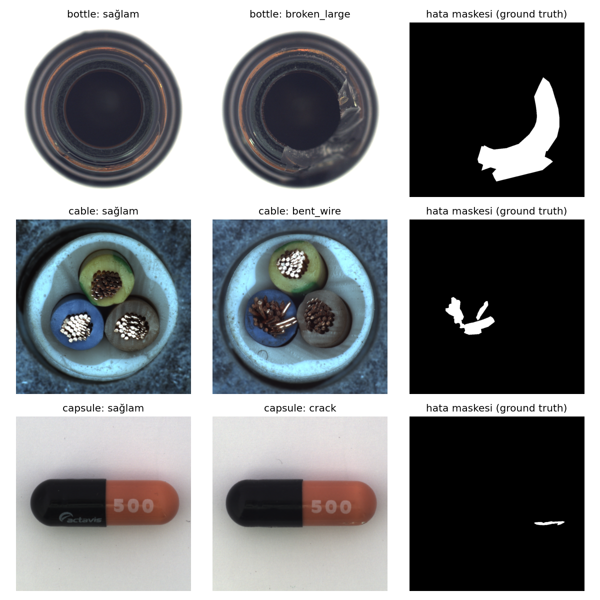
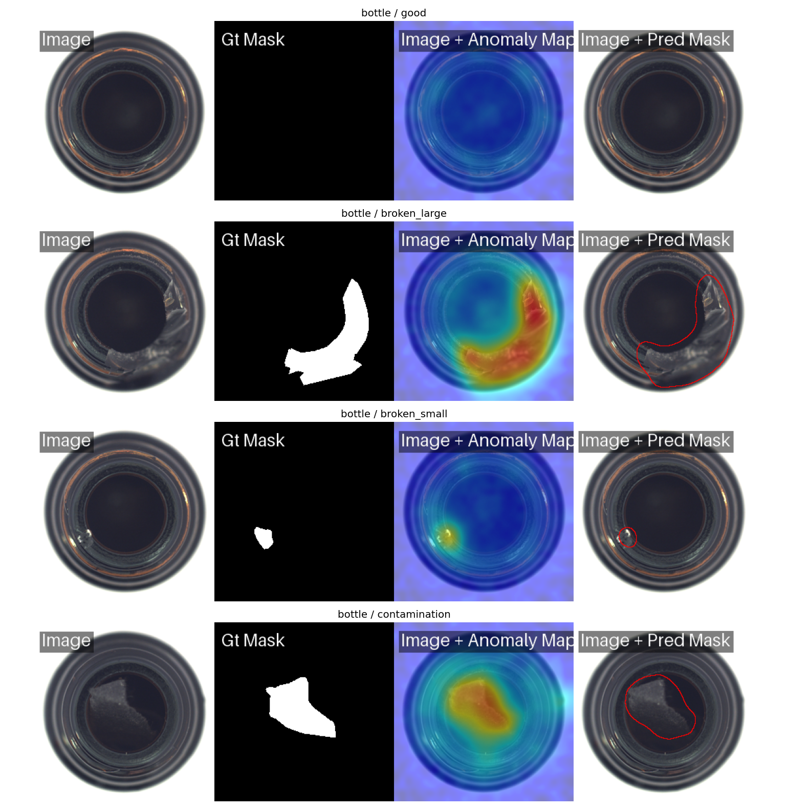
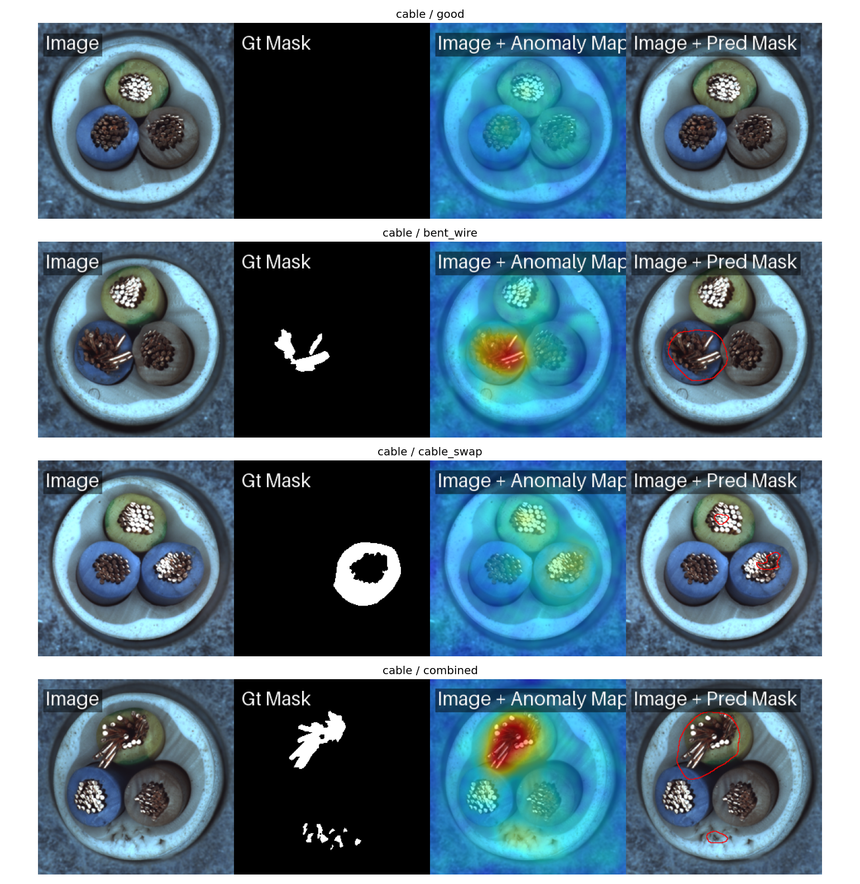
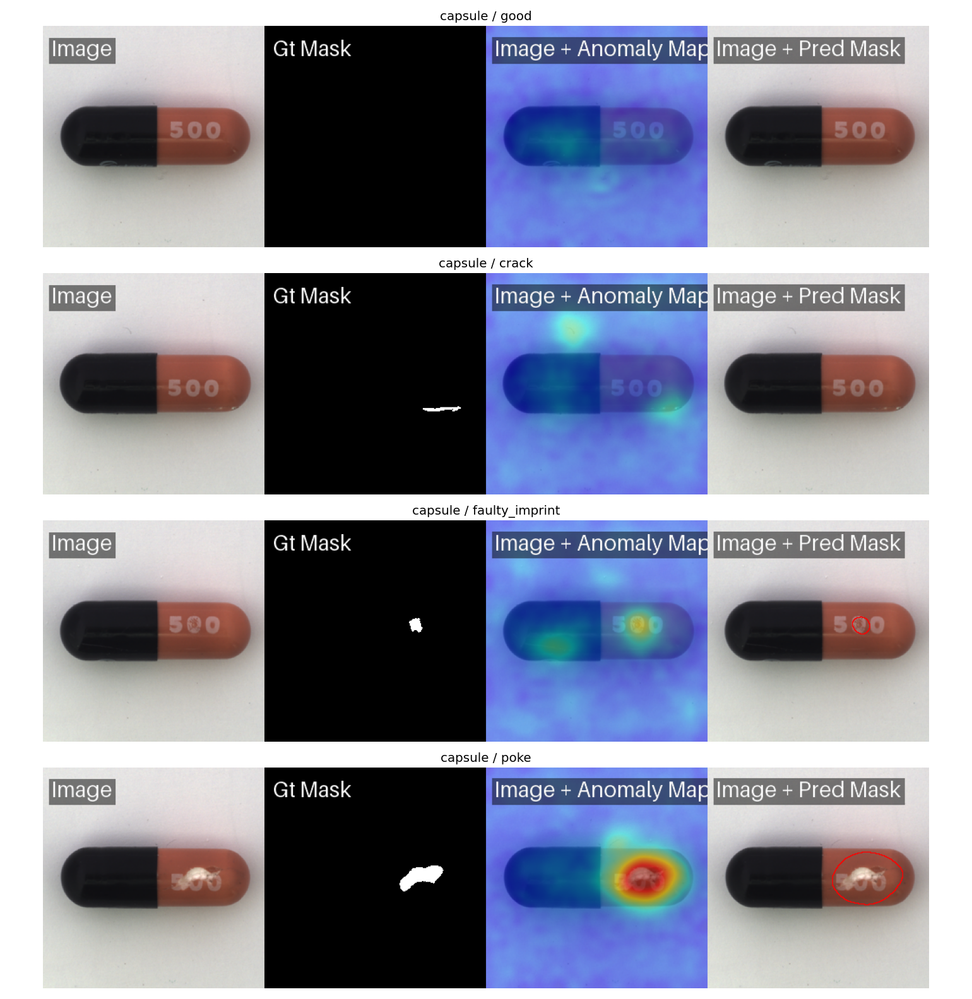
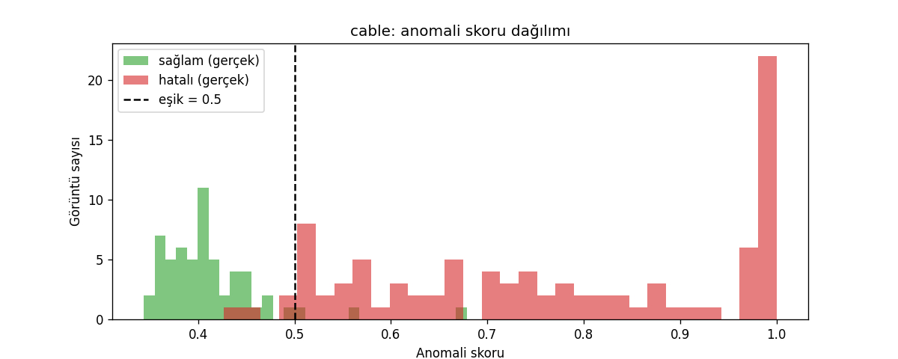
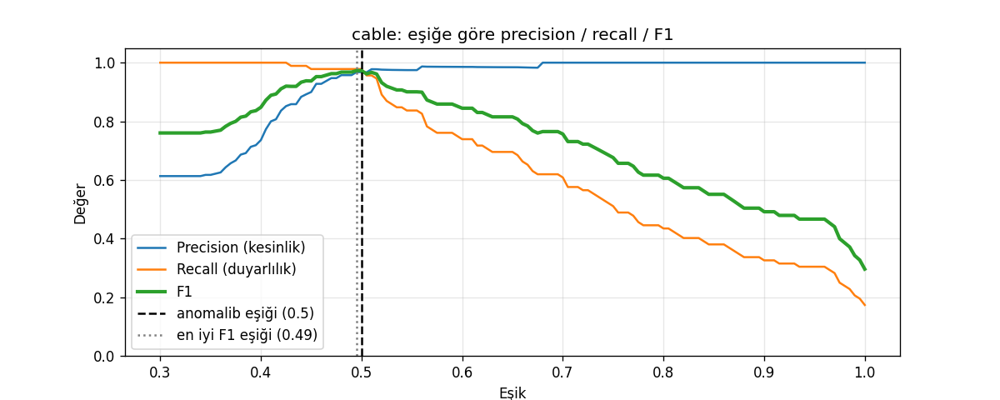
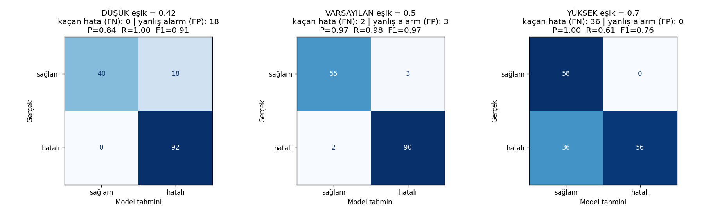

<div align="center">

# 🔍 Edge Anomaly Detection on Raspberry Pi 5

**Raspberry Pi 5 üzerinde gerçek zamanlıya yakın görsel anomali tespiti**
*Anomalib · PatchCore · OpenVINO · MVTec AD*


[](https://colab.research.google.com/github/ebrarklc/edge-anomaly-detection-rpi5/blob/main/notebooks/01_train_patchcore.ipynb)


*Raspberry Pi 5 üzerinde üretilmiş gerçek çıktılar. Sol: orijinal görüntü · Sağ: anomali haritası ve tahmin edilen hata bölgesi.*

</div>

---

## 📌 İçindekiler

- [Proje Hakkında](#-proje-hakkında)
- [Öne Çıkan Sonuçlar](#-öne-çıkan-sonuçlar)
- [Sistem Mimarisi](#️-sistem-mimarisi)
- [Yöntem: PatchCore](#-yöntem-patchcore)
- [Veri Seti](#-veri-seti-mvtec-ad)
- [Sonuçlar](#-sonuçlar)
- [Eşik Analizi](#️-eşik-analizi)
- [Raspberry Pi 5 Performansı](#-raspberry-pi-5-performansı)
- [Kurulum ve Kullanım](#-kurulum-ve-kullanım)
- [Proje Yapısı](#-proje-yapısı)
- [Karşılaşılan Sorunlar ve Çözümleri](#-karşılaşılan-sorunlar-ve-çözümleri)
- [Gelecek Çalışmalar](#-gelecek-çalışmalar)
- [Kaynaklar](#-kaynaklar)

---

## 🎯 Proje Hakkında

Endüstriyel kalite kontrolde **hatalı ürünler nadirdir** ve olası her hata türünü önceden toplayıp etiketlemek pratikte mümkün değildir. Bu yüzden klasik, denetimli sınıflandırma ya da nesne tespiti (ör. YOLO) yaklaşımları bu problem için her zaman uygun değildir.

Bu projede model **yalnızca sağlam ürün görüntüleriyle** eğitilir (*one-class / unsupervised learning*). Model "normal"in neye benzediğini öğrenir ve bundan sapan her şeyi **anomali** olarak işaretler. Ayrıca hatanın **nerede** olduğunu gösteren bir ısı haritası üretir.

Eğitilen model **OpenVINO** formatına dönüştürülüp bir **Raspberry Pi 5** üzerinde, PyTorch gerektirmeden çalıştırılır (**Edge AI**).

| | YOLO (nesne tespiti) | Bu proje (anomali tespiti) |
|---|---|---|
| Öğrenme türü | Denetimli | Denetimsiz (one-class) |
| Gereken veri | Etiketlenmiş, her sınıftan örnek | Yalnızca sağlam örnekler |
| Bulduğu şey | Önceden tanımlı sınıflar | "Normal"den her türlü sapma |
| Bilinmeyen yeni hata türü | Yakalayamaz | Yakalayabilir |

---

## ✨ Öne Çıkan Sonuçlar

- 🎯 **bottle** kategorisinde Raspberry Pi 5 üzerinde **83/83 doğru** sınıflandırma (TP=63, TN=20, FP=0, FN=0)
- ⚡ Pi 5 CPU'sunda görüntü başına **~517 ms** çıkarım süresi (**~1.9 FPS**)
- 📊 3 kategoride görüntü seviyesinde **AUROC ≥ 0.986**
- 🔄 PyTorch → ONNX → OpenVINO dönüşümünde **doğruluk kaybı yok**
- 🚀 Coreset seçimi: CPU'da **~70 dk**, T4 GPU'da **~72 sn** (yaklaşık 58 kat hızlanma)

---

## 🏗️ Sistem Mimarisi

Proje, Edge AI'ın klasik **"bulutta eğit, uçta çalıştır"** desenini izler:



---

## 🧠 Yöntem: PatchCore

[PatchCore](https://arxiv.org/abs/2106.08265) (Roth vd., CVPR 2022), **ezberleme tabanlı** (memory-based) bir anomali tespit yöntemidir. Geri yayılım (backpropagation) kullanmaz, eğitim tek bir geçişten ibarettir.



| Parametre | Değer |
|---|---|
| Backbone | `wide_resnet50_2` (ImageNet ön eğitimli) |
| Öznitelik katmanları | `layer2` (512 kanal) + `layer3` (1024 kanal) → 1536 boyut |
| Görüntü boyutu | 256 × 256 |
| Coreset oranı | 0.1 |
| En yakın komşu sayısı | 9 |

**Neden ara katmanlar?** İlk katmanlar çok basit özellikler (kenar, renk), son katmanlar ise ImageNet'e özgü anlamsal kavramlar öğrenir. Çizik, leke ve çatlak gibi hatalar **doku ve yerel yapı** seviyesinde görünür. Bu bilgi de ara katmanlarda bulunur.

**Neden coreset?** Coreset olmadan `bottle` için hafıza bankası 214.016 × 1536 × 4 bayt ≈ **1,3 GB** olurdu. %10 coreset ile bu **~131 MB**'a iner. 4 GB RAM'li bir Edge cihazı için bu fark kritiktir.

---

## 📦 Veri Seti: MVTec AD

[MVTec AD](https://www.mvtec.com/research-teaching/datasets/mvtec-ad), endüstriyel anomali tespitinin standart kıyaslama veri setidir. Bu projede farklı zorluk seviyelerindeki üç kategori kullanıldı:

<div align="center">

</div>

| Kategori | Eğitim (sağlam) | Test sağlam | Test hatalı | Hata türleri |
|---|---:|---:|---:|---|
| bottle | 209 | 20 | 63 | broken_large, broken_small, contamination |
| cable | 224 | 58 | 92 | bent_wire, cable_swap, combined, cut_inner/outer_insulation, missing_cable/wire, poke_insulation |
| capsule | 219 | 23 | 109 | crack, faulty_imprint, poke, scratch, squeeze |

> ⚠️ **Lisans:** MVTec AD, [CC BY-NC-SA 4.0](https://creativecommons.org/licenses/by-nc-sa/4.0/) lisansı altındadır (yalnızca ticari olmayan kullanım). Bu nedenle veri seti bu repoda **yer almaz**. Resmi siteden indirilmelidir.

---

## 📊 Sonuçlar

### Test metrikleri (Colab, T4 GPU)

| Kategori | Image AUROC | Image F1 | Pixel AUROC | Pixel F1 | Hafıza bankası | Model boyutu |
|---|---:|---:|---:|---:|---:|---:|
| bottle | **1.000** | 0.992 | 0.986 | **0.727** | 21.401 × 1536 | 230,9 MB |
| cable | 0.986 | 0.967 | 0.984 | 0.641 | 22.936 × 1536 | 240,4 MB |
| capsule | 0.993 | 0.979 | **0.990** | 0.515 | 22.424 × 1536 | 237,2 MB |

**Gözlemler:**

- **bottle** en kolay kategori: Sağlam ve hatalı görüntülerin skorları tamamen ayrışıyor (AUROC = 1.0).
- **cable**, görüntü seviyesinde en zorlanılan kategori. `cable_swap` gibi **mantıksal** hatalarda her yama tek başına normal görünür, sadece kabloların yeri yanlıştır. Yerel yamalara bakan PatchCore bu tür hatalarda doğal olarak zorlanır.
- **capsule**'de *pixel AUROC* yüksek (0.990) ama *pixel F1* düşük (0.515). İnce çatlaklar 32×32'lik yama ızgarasında ve 33×33'lük Gauss bulanıklaştırmasında "kalınlaşır". Model hatanın **yerini** bulur ama **sınırını** tam çizemez. Hatalı piksellerin toplam içindeki payı çok küçük olduğu için de AUROC, F1'e göre iyimser kalır.

### Anomali haritaları

<details>
<summary><b>bottle</b></summary>

</details>

<details>
<summary><b>cable</b></summary>

</details>

<details>
<summary><b>capsule</b></summary>

</details>

---

## 🎚️ Eşik Analizi

Model her görüntüye 0 ile 1 arasında normalize edilmiş bir **anomali skoru** verir. Skor eşiğin üstündeyse görüntü "hatalı" sayılır. Eşiğin yeri, **kaçan hata** ile **yanlış alarm** arasındaki dengeyi belirler. Bu analiz, modelin hata yaptığı **cable** kategorisi üzerinde yapıldı.

<div align="center">

</div>

<div align="center">

</div>

| Eşik | Kaçan hata (FN) | Yanlış alarm (FP) | Precision | Recall | F1 |
|---|---:|---:|---:|---:|---:|
| 0.42 (düşük) | **0** | 18 | 0.84 | **1.00** | 0.91 |
| 0.50 (varsayılan) | 2 | 3 | 0.97 | 0.98 | **0.97** |
| 0.70 (yüksek) | 36 | **0** | **1.00** | 0.61 | 0.76 |

<div align="center">

</div>

**Çıkarımlar:**

1. **Precision–recall ödünleşimi:** Eşik yükseldikçe precision artar, recall düşer.
2. **Eşik bir iş kararıdır:** "Hiçbir hata müşteriye gitmesin" deniyorsa eşik düşürülür (0.42 → FN = 0) ve yanlış alarmlar insan kontrolüne yönlendirilir.
3. **Metodolojik not:** Anomalib'in eşiği F1'i en yüksek yapacak şekilde seçtiği doğrulandı (en iyi F1 eşiği: 0.49). Bu eşik test verisi üzerinde seçildiği için F1 değerleri **iyimser** kabul edilmelidir. Gerçek bir uygulamada eşik ayrı bir doğrulama setinde belirlenmelidir.

---

## 🍓 Raspberry Pi 5 Performansı

**Donanım / yazılım:** Raspberry Pi 5 (4 GB RAM) · Debian 13 (trixie) · Python 3.13 · OpenVINO 2026.4.1 · CPU çıkarımı

**bottle** test seti (83 görüntü), `src/infer_images.py` ile:

| Metrik | Değer |
|---|---|
| Doğruluk | **1.000** (83/83) |
| Karışıklık matrisi | TP=63 · FN=0 · FP=0 · TN=20 |
| Çıkarım süresi (ortalama / medyan) | **517 ms** / 515 ms |
| Çıkarım süresi (min / max) | 511 ms / 640 ms |
| Verim | **~1.93 FPS** |
| Model yükleme + derleme | 5,1 sn |
| Model boyutu (FP32) | 220 MiB |

**Doğruluk korundu mu? (parity check)** Colab'daki PyTorch modelinde image AUROC = 1.000 elde edilmişti. Pi'daki OpenVINO modeli de 83/83 doğru sonuç verdi. Dışa aktarma sırasında doğruluk kaybı yaşanmadı.

**Süre nereye gidiyor?** Modelin içinde iki ana iş var:

| İş | Yaklaşık işlem sayısı |
|---|---:|
| Backbone (WideResNet50, layer3'e kadar) | ~10 milyar |
| En yakın komşu araması (1024 yama × 21.401 vektör × 1536 boyut) | **~67 milyar** |

Çıkarım süresinin büyük kısmı sinir ağında değil, **hafıza bankası aramasında** geçiyor. Bu nedenle en etkili optimizasyon, coreset oranını düşürerek bankayı küçültmektir (bkz. [Gelecek Çalışmalar](#-gelecek-çalışmalar)).

> 💡 ~1.9 FPS akıcı video için yetersiz olsa da kalite kontrol hattı için yeterlidir. Ürün kameranın önüne geldiğinde tek bir kare çekilip karar verilir.

---

## 🚀 Kurulum ve Kullanım

### 1. Eğitim (Google Colab)

1. MVTec AD'den istenen kategorileri [resmi siteden](https://www.mvtec.com/research-teaching/datasets/mvtec-ad) indirin (`bottle.tar.xz` vb.).
2. Arşivleri Google Drive'da `MyDrive/edge-anomaly-detection-rpi5/data/` klasörüne yükleyin.
3. Notebook'u açın ve çalışma zamanını **T4 GPU** yapın: [](https://colab.research.google.com/github/ebrarklc/edge-anomaly-detection-rpi5/blob/main/notebooks/01_train_patchcore.ipynb)
4. Hücreleri sırayla çalıştırın. Eğitilen modeller ve OpenVINO çıktıları Drive'daki `models/` ve `exports/` klasörlerine kaydedilir.

### 2. Raspberry Pi 5 kurulumu

```bash
# Sistem paketleri (kamera ve OpenCV, apt ile)
sudo apt update
sudo apt install -y python3-picamera2 python3-opencv git

# Repo ve sanal ortam
git clone https://github.com/ebrarklc/edge-anomaly-detection-rpi5.git
cd edge-anomaly-detection-rpi5
python3 -m venv --system-site-packages .venv   # apt paketlerini (picamera2, cv2) görebilmesi için
source .venv/bin/activate
pip install -r requirements-pi.txt
```

### 3. Model ve test verisini Pi'a kopyalama

```bash
# PC'den (model.xml ve model.bin, Drive'daki exports/<kategori>/weights/openvino/ klasöründen)
scp model.xml model.bin pi@<PI_IP>:~/edge-anomaly-detection-rpi5/models/bottle/
scp bottle.tar.xz pi@<PI_IP>:~/edge-anomaly-detection-rpi5/datasets/

# Pi'da
tar -xf datasets/bottle.tar.xz -C datasets/MVTecAD && rm datasets/bottle.tar.xz
```

### 4. Çıkarım

```bash
python src/infer_images.py \
    --model models/bottle/model.xml \
    --data  datasets/MVTecAD/bottle/test \
    --out   outputs/bottle
```

| Argüman | Açıklama | Varsayılan |
|---|---|---|
| `--model` | `model.xml` yolu | (zorunlu) |
| `--data` | Görüntü klasörü (alt klasörler dahil taranır) | (zorunlu) |
| `--out` | Isı haritalarının kaydedileceği klasör | `outputs` |
| `--threshold` | Anomali eşiği (0–1) | `0.5` |
| `--save-per-type` | Her türden kaydedilecek görsel sayısı | `2` |
| `--threads` | CPU iş parçacığı sayısı | otomatik |

---

## 📁 Proje Yapısı

```
edge-anomaly-detection-rpi5/
├── notebooks/
│   └── 01_train_patchcore.ipynb   # Colab: eğitim, değerlendirme, eşik analizi, dışa aktarma
├── src/
│   └── infer_images.py            # Pi: OpenVINO ile klasör üzerinde çıkarım + performans ölçümü
├── assets/                        # README görselleri
├── results/
│   └── results_summary.csv        # Test metrikleri
├── requirements-pi.txt
├── LICENSE
└── README.md

# Repoda bulunmayanlar (.gitignore)
├── datasets/    # MVTec AD (lisans gereği)
├── models/      # OpenVINO modelleri (~230 MB / kategori)
└── outputs/     # Çıkarım çıktıları
```

---

## 🧩 Karşılaşılan Sorunlar ve Çözümleri

| Sorun | Sebep | Çözüm |
|---|---|---|
| Windows'ta `torch 2.15.0+cpu` kuruldu, GPU görünmedi | PyTorch 2.15 artık yalnızca CUDA 13 paketi yayınlıyor, sürücü ise CUDA 12.5'e kadar destekliyordu | Kurulum sonrası doğrulama adımıyla tespit edildi. Eğitim Colab'a taşındı |
| MVTec AD otomatik indirilemedi (`FileNotFoundError`) | Anomalib'in kullandığı indirme bağlantıları kırık ([#3892](https://github.com/open-edge-platform/anomalib/issues/3892)) | Veri seti resmi siteden kurumsal hesapla elle indirildi |
| Colab'da `RecursionError` | Lightning'in `rich` ilerleme çubuğu ile `tqdm` arasında stdout çakışması | `Engine(enable_progress_bar=False)` |
| Colab'da GPU atanamadı | Ücretsiz GPU kotası doluydu | CPU'da eğitim (~70 dk). Model `.ckpt` dosyasından yüklenerek yeniden eğitim yapılmadan test edildi |
| ONNX dışa aktarmada `version_converter` traceback'leri | PyTorch'un minimum opset'i (18), Anomalib'in istediğinden (14) yüksek | Yakalanan (handled) bir uyarı, model opset 18 ile üretildi ve Pi'da sorunsuz çalıştı |
| Pi venv'inde `cv2` bulunamadı | `apt install` komutu toplu yapıştırma sırasında kayboldu | Komutlar tek tek çalıştırıldı. `--system-site-packages` ile apt paketleri venv'e açıldı |

---

## 🔭 Gelecek Çalışmalar

- [ ] **Doğruluk ile hız ödünleşimi:** `coreset_sampling_ratio=0.01` ile hafıza bankasını 10 kat küçültüp Pi'daki gecikmeyi ve AUROC'u karşılaştırmak
- [ ] **Canlı kamera modu:** Raspberry Pi Camera Module v2 (IMX219) + `picamera2` ile canlı çıkarım ve tarayıcıdan izlenebilen MJPEG yayını
- [ ] **Kendi veri seti:** Pi kamerasıyla gerçek bir nesnenin sağlam görüntülerini toplayıp model eğitmek (alan kayması / *domain shift* deneyi)
- [ ] **Nicemleme (quantization):** OpenVINO NNCF ile FP16 / INT8 dönüşümü ve boyut-hız-doğruluk karşılaştırması
- [ ] **İki aşamalı hat:** YOLO ile nesneyi bulma + PatchCore ile kırpılmış bölgede anomali arama
- [ ] **Doğru eşik seçimi:** Eşiği test seti yerine ayrı bir doğrulama setinde belirlemek

---

## 📚 Kaynaklar

- K. Roth, L. Pemula, J. Zepeda, B. Schölkopf, T. Brox, P. Gehler. *Towards Total Recall in Industrial Anomaly Detection.* CVPR 2022. [arXiv:2106.08265](https://arxiv.org/abs/2106.08265)
- P. Bergmann, M. Fauser, D. Sattlegger, C. Steger. *MVTec AD — A Comprehensive Real-World Dataset for Unsupervised Anomaly Detection.* CVPR 2019.
- [Anomalib](https://github.com/open-edge-platform/anomalib): Intel Open Edge Platform
- [OpenVINO Toolkit](https://github.com/openvinotoolkit/openvino)

---

<div align="center">

**Ebrar Kılıç** · [GitHub](https://github.com/ebrarklc)

*Bu proje, Edge AI dersi kapsamında geliştirilmiştir.*

</div>
